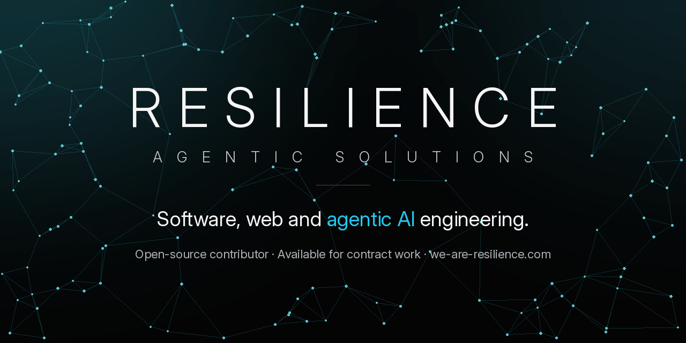

# RESILIENCE Agentic Solutions

  

I'm David Billiot, founder of RESILIENCE Agentic Solutions. **Senior engineering, built to endure.** Transparency builds credibility: you see the work as it happens, and every claim is backed by shipped code. Based in Miami and Abu Dhabi, working with clients and collaborators worldwide. Available for contract work.

I build custom software, web apps, AI agents and on-chain systems, and I contribute to open-source projects across AI, developer tools and blockchain. Security is part of the build from day one.

[we-are-resilience.com](https://we-are-resilience.com) · [Services](https://we-are-resilience.com/services) · [Work](https://we-are-resilience.com/work) · [Contact](https://we-are-resilience.com/contact)

## What I build

- **Custom software:** internal tools, APIs, workflows and integrations, plus audits of apps already in production.
- **Web and mobile apps:** product sites and customer apps, maintained by the engineer who built them.
- **AI agents and automation:** agents for support, bookings, operations and reporting.
- **On-chain systems:** smart contracts and blockchain integrations.
- **A business operating system in production:** my company runs on a back office I built: clients, projects, contracts, invoicing, revenue, scheduling, email campaigns, analytics and a client portal in one dashboard. It integrates Stripe payments, Mercury banking, Resend email, Supabase and Vercel, and its own MCP server lets AI agents securely run bookings, outreach and casework.
- **Client-facing by design:** a client portal with real-time project progress, an AI front desk that answers only from published pricing, and a case manager for personal data removal.
- **Built for safety:** two-factor admin sign-in, an audited kill switch on outbound email, and rate-limited, deduplicated outreach. Typecheck, lint and a large test suite gate every change.
- **Detail you can feel:** I hold every screen to a premium standard. Spacing, wording placement, color, transparency and widget layout all have to work together, and I catch the scroll jitter, blur and layout shift most people never see.

## Open source

Full track record: [we-are-resilience.com/open-source](https://we-are-resilience.com/open-source)

**Merged**
- agent-of-empires/agent-of-empires: [#4477](https://github.com/agent-of-empires/agent-of-empires/pull/4477) · anthropics/buffa: [#713](https://github.com/anthropics/buffa/pull/713) · anthropics/claude-code-action: [#1702](https://github.com/anthropics/claude-code-action/pull/1702), [#1704](https://github.com/anthropics/claude-code-action/pull/1704) · awslabs/ferret-scan: [#760](https://github.com/awslabs/ferret-scan/pull/760) · facebook/astryx: [#7528](https://github.com/facebook/astryx/pull/7528) · paradigmxyz/reth: [#27899](https://github.com/paradigmxyz/reth/pull/27899)

**In review**
- ChainSafe/lodestar: [#10383](https://github.com/ChainSafe/lodestar/pull/10383) · NVIDIA/dcgm-exporter: [#758](https://github.com/NVIDIA/dcgm-exporter/pull/758) · NVIDIA/gpu-operator: [#3076](https://github.com/NVIDIA/gpu-operator/pull/3076) · OpenZeppelin/compact-contracts: [#1121](https://github.com/OpenZeppelin/compact-contracts/pull/1121) · anthropics/claude-code-action: [#1902](https://github.com/anthropics/claude-code-action/pull/1902) · facebook/stylex: [#1950](https://github.com/facebook/stylex/pull/1950) · microsoft/TypeChat: [#458](https://github.com/microsoft/TypeChat/pull/458) · microsoft/mcp: [#3936](https://github.com/microsoft/mcp/pull/3936)

Client work lives in private repositories.

## Contact

[info@we-are-resilience.com](mailto:info@we-are-resilience.com) · [Book a call](https://we-are-resilience.com/contact)
