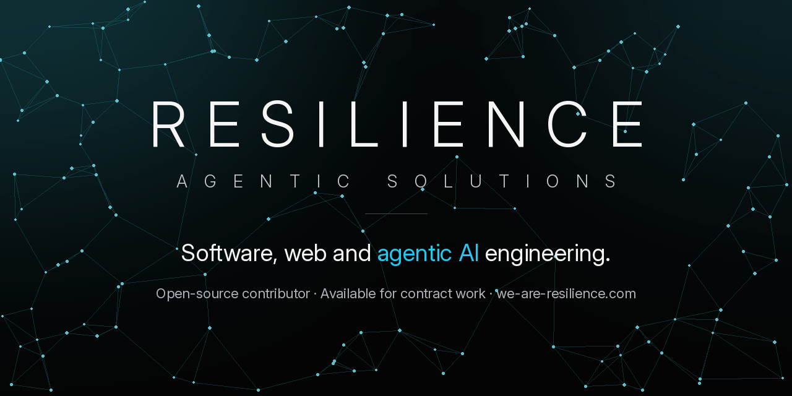

# RESILIENCE Agentic Solutions

  

I'm David Billiot, founder of RESILIENCE Agentic Solutions. **Senior engineering, built to endure.** I design and ship production SaaS, web apps and AI agents, and my code is merged upstream at NVIDIA, Anthropic, Meta and Microsoft.

Based in Miami and Abu Dhabi, working with clients worldwide. Security is part of the build from day one. Available for remote contract work.

[we-are-resilience.com](https://we-are-resilience.com) · [Services](https://we-are-resilience.com/services) · [Work](https://we-are-resilience.com/work) · [Contact](https://we-are-resilience.com/contact)

## What I build

- **SaaS products:** I design and ship subscription software end to end, from Stripe Apps and Stripe Billing to Cloudflare Workers and Supabase back ends, with test coverage and CI in place before launch.
- **Custom software:** internal tools, APIs and integrations engineered for long-term maintainability, plus technical audits of systems already in production.
- **Web and mobile apps:** fast, accessible product sites and customer apps on Next.js, React and Tailwind, maintained by the engineer who built them.
- **AI agents and automation:** production agents for support, bookings and repetitive operational work, informed by my merged contributions to NVIDIA's agent tooling.
- **GPU and infrastructure:** merged fixes in NVIDIA's cudf and gpu-operator, written in Python and Go, and reviewed by NVIDIA maintainers.
- **Security reviews:** exposure reports and assurance for sites, software and agents already live. Testing starts only after the scope is signed.
- **Personal data removal:** people-search listings taken down, with a written record of where a name was found.
- **Detail you can feel:** I hold every screen to a premium standard. Spacing, wording, color and layout have to work together, and I catch the scroll jitter, blur and layout shift most people never see.

## Tech stack

| Area | Technologies |
| --- | --- |
| **Languages** |  TypeScript ·  JavaScript ·  Python ·  Go ·  Rust ·  SQL / PL/pgSQL ·  Bash ·  CSS |
| **Frontend** |  Next.js (App Router) ·  React ·  Tailwind CSS ·  Radix UI / shadcn · Motion · StyleX · Lexical · TipTap |
| **Backend & data** | Supabase (Postgres · Auth · RLS) ·  PostgreSQL ·  Drizzle ORM ·  Zod ·  Upstash Redis · REST APIs |
| **Cloud & infrastructure** |  Vercel · Cloudflare Workers (Queues · Cron · Wrangler) ·  Docker ·  Kubernetes GPU operators |
| **Payments & email** |  Stripe Billing ·  Stripe Apps ·  Resend · React Email · Web Push |
| **AI & agents** | Multi-agent systems ·  Model Context Protocol (MCP) ·  NVIDIA NeMo Agent Toolkit ·  Claude Code Action |
| **Testing & quality** | Playwright · axe accessibility ·  Vitest ·  Testing Library ·  Jest ·  ESLint ·  Prettier |
| **DevOps & observability** |  GitHub Actions ·  Dependabot ·  Sentry ·  PostHog ·  pnpm workspaces |
| **Security** | App security reviews · secret redaction · auth hardening ·  Cloudflare Turnstile |

## Open source

Full track record: [we-are-resilience.com/open-source](https://we-are-resilience.com/open-source)

> **Featured** · [NVIDIA/cudf #24992](https://github.com/NVIDIA/cudf/pull/24992): *Report non-literal str.slice offsets accurately in cudf-polars*
> Approved by NVIDIA maintainer [@TomAugspurger](https://github.com/TomAugspurger) and merged on November 3, 2026.

### Merged

| Organization | Project | Pull requests |
| --- | --- | --- |
| NVIDIA | [cudf](https://github.com/NVIDIA/cudf) | [#24992](https://github.com/NVIDIA/cudf/pull/24992) |
| NVIDIA | [gpu-operator](https://github.com/NVIDIA/gpu-operator) | [#3076](https://github.com/NVIDIA/gpu-operator/pull/3076) |
| NVIDIA | [NeMo-Agent-Toolkit](https://github.com/NVIDIA/NeMo-Agent-Toolkit) | [#2392](https://github.com/NVIDIA/NeMo-Agent-Toolkit/pull/2392) · [#2426](https://github.com/NVIDIA/NeMo-Agent-Toolkit/pull/2426) · [#2428](https://github.com/NVIDIA/NeMo-Agent-Toolkit/pull/2428) ([case study](writeups/nemo-agent-toolkit-2428.md)) · [#2519](https://github.com/NVIDIA/NeMo-Agent-Toolkit/pull/2519) ([case study](writeups/nemo-agent-toolkit-2519.md)) |
| Anthropic | [buffa](https://github.com/anthropics/buffa) | [#713](https://github.com/anthropics/buffa/pull/713) ([case study](writeups/buffa-713.md)) |
| Anthropic | [claude-code-action](https://github.com/anthropics/claude-code-action) | [#1702](https://github.com/anthropics/claude-code-action/pull/1702) · [#1704](https://github.com/anthropics/claude-code-action/pull/1704) |

Show all merged contributions

| Organization | Project | Pull requests |
| --- | --- | --- |
| agent-of-empires | [agent-of-empires](https://github.com/agent-of-empires/agent-of-empires) | [#4477](https://github.com/agent-of-empires/agent-of-empires/pull/4477) ([case study](writeups/agent-of-empires-4477.md)) · [#4772](https://github.com/agent-of-empires/agent-of-empires/pull/4772) |
| AWS Labs | [ferret-scan](https://github.com/awslabs/ferret-scan) | [#760](https://github.com/awslabs/ferret-scan/pull/760) ([case study](writeups/ferret-scan-760.md)) |
| Meta | [astryx](https://github.com/meta/astryx) | [#7528](https://github.com/meta/astryx/pull/7528) ([case study](writeups/astryx-7528.md)) |
| Meta | [lexical](https://github.com/meta/lexical) | [#9396](https://github.com/meta/lexical/pull/9396) |
| Microsoft | [TypeChat](https://github.com/microsoft/TypeChat) | [#458](https://github.com/microsoft/TypeChat/pull/458) |
| Paradigm | [reth](https://github.com/paradigmxyz/reth) | [#27899](https://github.com/paradigmxyz/reth/pull/27899) ([case study](writeups/reth-27899.md)) |

### In review

| Organization | Project | Pull requests |
| --- | --- | --- |
| NVIDIA | [cudf](https://github.com/NVIDIA/cudf) | [#24990](https://github.com/NVIDIA/cudf/pull/24990) |
| NVIDIA | [dcgm-exporter](https://github.com/NVIDIA/dcgm-exporter) | [#758](https://github.com/NVIDIA/dcgm-exporter/pull/758) |
| Anthropic | [claude-code-action](https://github.com/anthropics/claude-code-action) | [#1902](https://github.com/anthropics/claude-code-action/pull/1902) |

Show all open pull requests

| Organization | Project | Pull requests |
| --- | --- | --- |
| ChainSafe | [lodestar](https://github.com/ChainSafe/lodestar) | [#10383](https://github.com/ChainSafe/lodestar/pull/10383) |
| Meta | [astryx](https://github.com/meta/astryx) | [#9551](https://github.com/meta/astryx/pull/9551) |
| Meta | [stylex](https://github.com/meta/stylex) | [#1950](https://github.com/meta/stylex/pull/1950) |
| Microsoft | [mcp](https://github.com/microsoft/mcp) | [#3936](https://github.com/microsoft/mcp/pull/3936) |

Client work lives in private repositories.

## Contact

[info@we-are-resilience.com](mailto:info@we-are-resilience.com) · [Book a call](https://we-are-resilience.com/contact)
